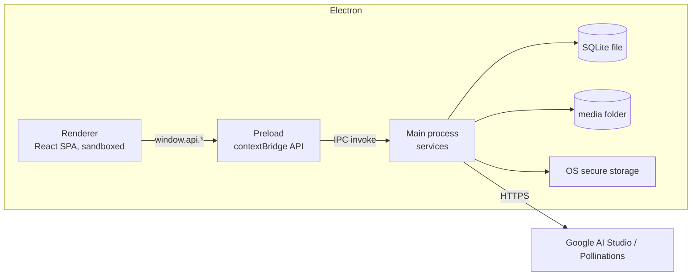

# MemBetter v1: Local-first Electron app (Anki style)

Status: proposal. Date: 2026-10-18. Replaces the server in `SYSTEM_DESIGN.md` for the first version; that document stays as the
plan for a later cloud edition.

## 1. Goal and scope

Ship a desktop app (Windows, macOS, Linux) that works like Anki: everything is stored on the user's computer, it works
offline, there are no accounts, and a whole course can be exported to one file and imported on another computer.

**In scope**
- All current screens: Home, Create Course, Course Editor, Course detail, session picker, AI Word Assistant.
- Local database and local media files.
- Export and import of a whole course as one file (`.membetter`), plus optional Anki (`.apkg`) export.
- Whole-library backup and restore.
- Real study sessions (learn, classic review, speed review) with spaced repetition, since an Anki-like app needs them.
- AI Word Assistant, with the user's own keys stored in the operating system's secure storage.

**Out of scope for v1**: accounts, cloud sync, public course sharing, a server, a leaderboard (it needs other users),
mobile apps. Sharing a course in v1 means sending the exported file.

Hosting cost: **R$ 0 per month** (no server). Only optional yearly costs: code-signing certificates (section 9).

## 2. Architecture



- **Renderer**: the existing React app. It never touches the disk or the network directly.
- **Preload**: exposes a small typed `window.api` (courses, levels, words, media, study, export, settings, ai). Nothing else.
- **Main process**: owns SQLite, the media folder, secret storage, import/export and AI calls. One service module per area.
- **Security**: `contextIsolation: true`, `nodeIntegration: false`, `sandbox: true`, strict CSP, no remote content loaded,
  navigation locked to the app, media served through a custom protocol `membetter-media://<hash>` (not `file://`).

## 3. Technology choices

| Concern | Choice | Why |
|---------|--------|-----|
| Shell | Electron (current stable) with `electron-vite` | Vite is already used; one config for main, preload and renderer |
| Database | **SQLite** through `better-sqlite3` in the main process | Same model as Anki; one file; fast; synchronous API is fine in the main process; WAL mode |
| Migrations | Numbered SQL files, applied at startup, tracked by `PRAGMA user_version` | Simple, versioned, safe upgrades |
| Media | Files in `<userData>/media/<sha256>.<ext>`, content-addressed | Deduplication, easy export, easy cleanup by reference |
| IPC contract | Shared TypeScript types plus `zod` validation of every IPC payload in main | Renderer is untrusted by default |
| Zip | `fflate` (or `yazl`/`yauzl`) | Streams, no native build |
| Spaced repetition | `ts-fsrs` (FSRS algorithm, used by modern Anki) | Better scheduling than SM-2, no need to write it |
| Secrets | Electron `safeStorage` (Keychain, DPAPI, libsecret) | Keys stay encrypted by the OS account |
| Packaging | `electron-builder` | Installers and auto-update |
| Tests | Vitest (services, import/export), Playwright for Electron (a few flows) | Frontend has no tests today |

The frontend keeps React, Tailwind, React Router and Zustand. Zustand stops persisting to `localStorage`; it becomes a cache
of what `window.api` returned.

## 4. Data model (SQLite)

Same shape as section 5 of `SYSTEM_DESIGN.md`, simplified for one local user. Ids are UUID strings so exported courses never
collide on import.

- `courses` (id, title, teaching_language_id, speakers_language_id, category_id, tags JSON, description, short_description,
  cover_media_hash, created_at, updated_at, deleted_at)
- `levels` (id, course_id, position, name, tested)
- `words` (id, level_id, position, text, meaning, example, ipa, created_at, updated_at)
- `word_media` (word_id, media_hash, kind image|audio, position): at most 5 of each per word
- `media` (hash pk, kind, content_type, size_bytes, original_name, created_at)
- `course_settings` (course_id pk, daily_goal, hidden_at, new_per_day, desired_retention)
- `cards` (word_id pk, state, due_at, stability, difficulty, reps, lapses, last_review_at, ignored, in_long_term)
- `review_log` (id, word_id, rating, reviewed_at, elapsed_days, scheduled_days): needed for statistics and for FSRS optimization
- `settings` (key, value): language, theme, AI model names, last backup time
- Languages and categories stay as static data in code (no table needed).

Derived counts (total, learned, due, ignored, long term) are SQL queries/views, replacing the frontend selectors and the
invented counts in the sample data. The fixed sample courses become an optional "Install sample courses" import.

## 5. Export and import (the core feature)

### 5.1 Native format: `.membetter`

A ZIP file (renamed extension) with this layout:

```text
course.membetter
├── manifest.json     { format: "membetter-course", formatVersion: 1, appVersion, exportedAt, courseId, counts }
├── course.json       course fields, levels in order, words in order, media references by hash
├── media/<sha256>.<ext>   every image and audio file the course uses
└── progress.json     (optional) cards and review log, only when the user ticks "Include my progress"
```

- **Export**: right-click a course (or the options menu) then "Export course". The main process builds the zip with
  streaming (no big memory use), shows a save dialog, and reports progress. Default is content only; progress is optional.
- **Import**: File menu or drag and drop a `.membetter` file. The app validates `manifest.json` and the schema (`zod`), checks the
  format version, rejects paths outside `media/` (zip-slip), limits total size and file count, verifies each media hash,
  then writes everything in **one database transaction**. If a course with the same id exists the user chooses
  "Replace", "Import as copy" (new ids) or "Cancel".
- **Round trip guarantee**: an automated test exports a course, imports it into an empty database and compares everything.
- **Forward compatibility**: `formatVersion` is checked; older versions are migrated on import; newer versions give a clear
  "update the app" message.
- **Export all**: the same format with several courses in one `library.membetter` (a `courses/<id>/` folder per course), used
  for backup (section 5.3).

### 5.2 Anki compatibility

- **Export to `.apkg`** (phase 5, optional): builds a SQLite `collection.anki2` plus `media` mapping, one note per word (fields
  word, meaning, example, IPA, image, audio), one deck per course with sub-decks per level. This lets users study in Anki.
- **Import from `.apkg`** and CSV/TSV (later): read-only parsing of notes into a new course. Start with CSV because it is
  simple and covers most shared word lists.
- These are best-effort conversions: MemBetter's native `.membetter` is the lossless format.

### 5.3 Backup and restore

- Automatic backup on app start and every N days to a user-chosen folder (default `Documents/MemBetter Backups`), keeping the
  last 10; uses SQLite's online backup API plus a copy of new media files, so it is consistent while the app runs.
- "Restore from backup" and "Export entire library" use the same code as course import.
- The user can also point the data folder at a synced folder (Dropbox, Google Drive, Syncthing), with a warning not to open the
  same library on two computers at the same time (see risks).

## 6. Feature by feature

| Feature | Local implementation |
|---------|----------------------|
| Home dashboard | `courses:listWithProgress(filter)` SQL query; goals and hide/restore stored in `course_settings` |
| Create Course | `courses:create` with the same validation as the form (validation shared between renderer and main) |
| Course Editor | `levels:*` and `words:*` calls; autosave debounced 400 ms into SQLite; "Saved" indicator |
| Images and audio | File picker or drag and drop; main validates size/type/magic bytes (images 2 MB, audio 3 MB, max 5 each), hashes, copies into `media/`; images re-encoded to strip metadata |
| Media cleanup | On startup and after deletes: remove files with no `word_media` or cover reference (replaces the IndexedDB diff logic) |
| Course detail | Same data from SQL; the leaderboard tab is replaced by personal statistics (streak, reviews per day, retention) |
| Session picker and study | `study:next(kind)` and `study:answer(rating)` using `ts-fsrs`; learn = new words in level order, classic review = due cards, speed review = timed due cards |
| AI Word Assistant | Runs in main: reads the key from `safeStorage`, calls Google/Pollinations, saves audio/image to `media/`, returns hashes. Prompts and "no text in picture" rules move to main. The renderer never sees the keys |
| Connect AI dialog | Shows "connected" only; keys saved with `safeStorage.encryptString` in the settings store |
| Migration from the web prototype | A one-time "Import from browser version" for people with data in `localStorage`/IndexedDB: the web build gets an "Export my data" button that produces a `.membetter` file |

## 7. Project structure

```text
/
├── src/                 existing React app (renderer)
├── electron/
│   ├── main/            app lifecycle, windows, protocol, menus
│   ├── preload/         contextBridge API
│   ├── services/        courses, levels, words, media, study, exchange (import/export), backup, ai, settings
│   ├── db/              connection, migrations/*.sql
│   └── shared/          IPC types and zod schemas (also imported by the renderer)
├── electron.vite.config.ts
├── electron-builder.yml
└── package.json
```

## 8. Roadmap

| Phase | Scope | Result |
|-------|-------|--------|
| 0. Shell (about 3 to 5 days) | `electron-vite` setup, secure window, preload skeleton, SQLite + migrations, CI build for the three platforms | The existing UI runs inside Electron |
| 1. Data layer (about 1 to 2 weeks) | Schema, services for courses/levels/words, typed IPC, replace `learnerStore` and `useAllCourses`/`useCourseLevels` with API-backed hooks, autosave | Home, Create, Editor, Details work from SQLite |
| 2. Media (about 1 week) | Media service, custom protocol, validation, cleanup, remove the IndexedDB wrapper | Images and audio on disk |
| 3. Export and import (about 1 to 2 weeks) | `.membetter` writer and reader, conflict choices, zip safety, round-trip tests, drag and drop, export all, backups and restore | The central feature done |
| 4. AI (about 1 week) | Move Gemini/Pollinations calls to main, `safeStorage` keys | Assistant works without exposing keys |
| 5. Study engine (about 2 weeks) | `ts-fsrs`, learn/classic/speed sessions, stats, daily goals | Real Anki-like studying |
| 6. Anki interop (about 1 week, optional) | `.apkg` export, CSV import | Move data to and from Anki |
| 7. Release (about 1 week) | Installers, code signing, auto-update, crash reporting opt-in, privacy text | Public v1 |

Total: about 8 to 11 weeks for one developer; phases 0 to 3 already give a usable, exportable app.

## 9. Distribution and cost

- **Hosting**: none. **Monthly cost: R$ 0.**
- **Installers**: `electron-builder`. Unsigned apps show warnings: Windows SmartScreen and macOS Gatekeeper.
  - macOS: Apple Developer Program, about US$ 99 per year (billed in USD), needed for signing and notarization.
  - Windows: a code-signing certificate, about US$ 100 to US$ 300 per year; some Brazilian resellers sell them in BRL (confirm price).
  - Linux: AppImage/deb need no signing.
- **Auto-update**: `electron-updater` from GitHub Releases (free) or a bucket.
- **Domain / email**: optional, only if you want a site or support address (`.com.br`, about R$ 40 per year).
- Cheapest launch: skip signing at first and ship to testers with a "how to open" note; add signing before a public release.

## 10. Risks

| Risk | Mitigation |
|------|------------|
| Data loss (disk failure, deleted folder) | Automatic backups, easy "Export all", clear backup status in settings |
| Corrupt or malicious import file | Zip-slip checks, size/count limits, schema and hash validation, single transaction, sandboxed parsing |
| Schema changes break old exports | `formatVersion` plus migration on import; round-trip tests kept in CI for every released version |
| Two computers editing the same synced folder | Warn in the UI; SQLite lock file check; real sync is a later cloud edition |
| Electron security mistakes | The hardening list in section 2, `electron-builder` fuses, dependency audit in CI |
| Large media makes exports big | Image shrinking on import, size limits, progress UI, streaming zip |
| AI provider API changes | Provider adapters isolated in `services/ai`, editable model names, recorded-response tests |
| Unsigned installers scare users | Plan signing before public release |

## 11. Open decisions

1. **Library location**: fixed in the app data folder (simple) or user-selectable (better for synced folders)?
2. **Export default**: content only, or include progress by default?
3. **Anki interop priority**: is `.apkg` export needed in v1 or can it wait?
4. **Study algorithm**: FSRS (recommended) or a simpler SM-2?
5. **Platforms for v1**: all three, or Windows and macOS first?
6. **Later cloud edition**: keep the schema ids and `.membetter` format ready for sync, and reuse `SYSTEM_DESIGN.md` then?
