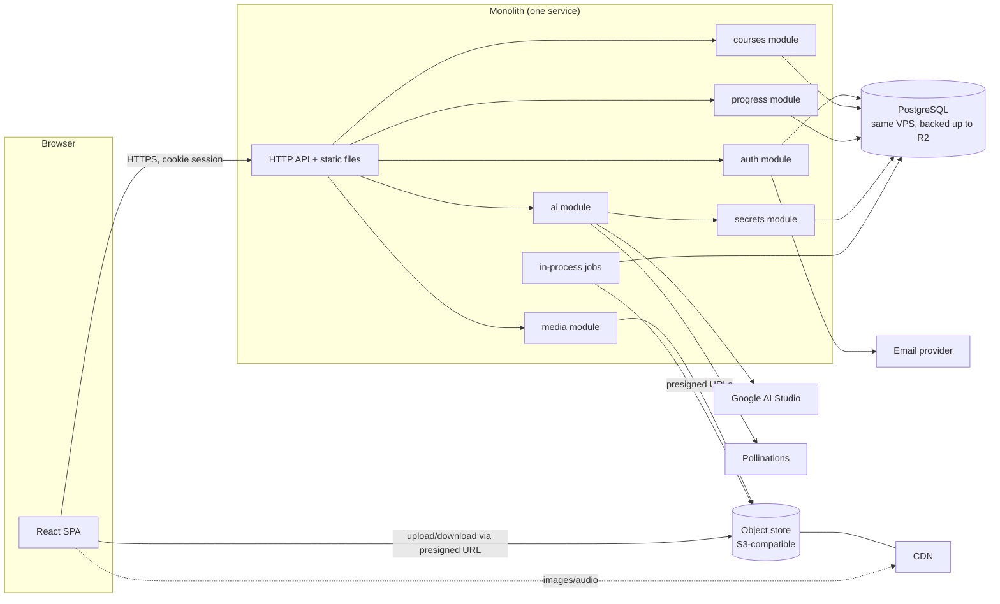
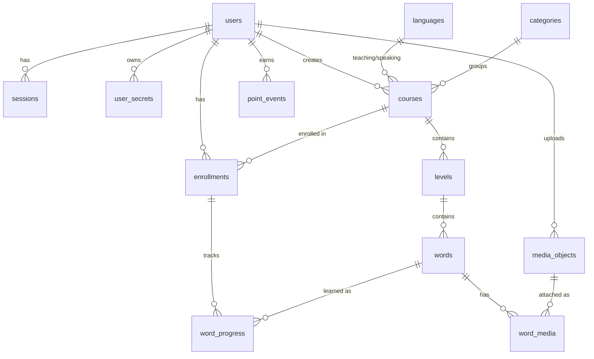
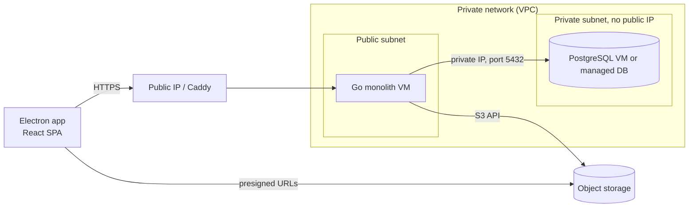

# MemBetter: Monolith Backend and System Design

Status: proposal (hosting revised for stability). Date: 2026-10-18. Backend language: **Go** (decided).

This document plans a **monolith backend written in Go** that makes every feature of the current frontend-only prototype work
for real: accounts and login, courses stored in an external database, images and audio stored in an image
(object) store, and each user's third-party API secrets managed safely on the server. It ends with a stable, low-cost
hosting recommendation and the monthly bill.

Contents: [1. Where we are](#1-where-we-are) · [2. Goals and non-goals](#2-goals-and-non-goals) ·
[3. Architecture](#3-architecture) · [4. Technology choices](#4-technology-choices) ·
[5. Data model](#5-data-model) · [6. API](#6-api) · [7. Authentication and sessions](#7-authentication-and-sessions) ·
[8. User secrets management](#8-user-secrets-management) · [9. Image and audio store](#9-image-and-audio-store) ·
[10. Feature by feature](#10-feature-by-feature) · [11. Frontend changes](#11-frontend-changes) ·
[12. Security](#12-security) · [13. Operations](#13-operations) · [14. Hosting and cost](#14-hosting-and-cost) ·
[15. Roadmap](#15-roadmap) · [16. Risks](#16-risks) · [17. Open decisions](#17-open-decisions)

---

## 1. Where we are

Today the app is a React 19 + Vite + TypeScript single-page app with **no server**. Everything lives in the
visitor's browser:

| Data | Where it is stored now | Problem |
|------|------------------------|---------|
| Goals, removed courses, created courses, course edits, levels and words | `localStorage` key `membetter.learner` (Zustand `persist`) | Lost if the browser data is cleared; not shared between devices; no real users |
| Imported images and audio, AI audio and pictures | IndexedDB database `membetter-media` | Same, plus a browser storage quota |
| Google AI Studio key, Pollinations key, model names | `localStorage` key `membetter.ai` | Secrets sit in the browser where any script can read them; each device needs the keys again |
| Sample courses, levels, leaderboard | Static data in the code | Not real; the leaderboard is fixed sample data |
| Login, creator, "You" | None (one anonymous learner) | No accounts |

Features that already exist in the frontend and must keep working: Home dashboard (course cards, progress,
goals, filters, remove/restore), Create Course form, Course Editor (levels, words, images, audio, IPA, details),
Course detail page (levels, leaderboard, edit link), session picker (learn, classic review, speed review,
currently placeholders), and the AI Word Assistant (definition, sentences, IPA, audio from Google, picture from
Pollinations).

## 2. Goals and non-goals

**Goals**
1. Real accounts: sign up, log in, log out, reset password, optional "Sign in with Google".
2. All course data in an **external managed database** (PostgreSQL) instead of the browser.
3. All images and audio in an **external object store** (S3-compatible), not in the database or the browser.
4. Each user's AI API keys (and any other user secrets) stored **encrypted on the server** and never sent back
   to the browser; AI calls are made **by the server** on the user's behalf.
5. One deployable **monolith**: a single Go codebase that compiles to **one static binary** which serves the API
   and the built React app (embedded in the binary).
6. Stable, always-on, low-cost hosting (no free tiers, about $7 to $12 or R$ 80 to R$ 125 per month at launch, payable in reais, see 14.7), with a clear upgrade path.

**Non-goals (for now)**: microservices, real-time collaboration, native mobile apps, payments, a message broker,
a Kubernetes cluster, multi-region. The monolith is structured in modules so any of these can be split out
later if ever needed.

## 3. Architecture

### 3.1 Overview



### 3.2 Monolith rules

- **One process, one repository, one deploy.** The backend is a Go service in `server/` whose single binary also
  serves the built SPA (embedded with `go:embed`, or read from `dist/` in development). No other service has to run except PostgreSQL (on the same server, or a managed one later) and the external object store.
- **Modular monolith**: each module owns its tables and exposes a small service interface. Modules call each other
  through those interfaces, never through each other's tables. Modules are Go packages under `internal/`: `auth`, `users`, `secrets`, `courses`
  (courses, levels, words), `media`, `ai`, `progress` (learning state, goals, leaderboard), `sessions`
  (review scheduling). Go's `internal/` rule and unexported identifiers enforce the module boundaries at compile time.
- **Stateless process**: sessions live in the database, files in the object store, so the service can be
  restarted or scaled to several instances without losing anything.
- **In-process jobs** (cleanup of orphaned media, expired sessions, recomputing leaderboards) run as goroutines on a
  ticker in the same process. If a second instance is added later, a database advisory lock keeps a job from running twice.

### 3.3 Repository layout

```text
/                       (repository root)
├── src/                existing React app (frontend, built to dist/)
├── server/             new Go monolith (one Go module)
│   ├── cmd/membetter/        main.go: wiring, config, start, graceful shutdown
│   ├── internal/
│   │   ├── config/           validated environment variables
│   │   ├── httpapi/          router, middleware, handlers, error mapping, static files (go:embed)
│   │   ├── db/               pgx pool, sqlc-generated queries, migrations/
│   │   ├── auth/  users/  secrets/  courses/  media/  ai/  progress/  sessions/
│   │   ├── platform/         crypto, email, ratelimit, storage (S3), logging
│   │   └── jobs/             background goroutines
│   ├── api/openapi.yaml      the API contract (single source of truth)
│   ├── Dockerfile            multi-stage build to a distroless image (about 20 MB)
│   └── go.mod
├── SYSTEM_DESIGN.md    this document
└── package.json        frontend workspace (pnpm)
```

**One contract for both sides.** `server/api/openapi.yaml` describes every request and response. The Go server
types and handler interfaces are generated from it (`oapi-codegen`), and the TypeScript client and types for the
React app are generated from the same file (`openapi-typescript`). The frontend and the backend therefore cannot
disagree about a field, even though they are written in different languages.

## 4. Technology choices

| Concern | Choice | Why |
|---------|--------|-----|
| Language | **Go 1.24+** (latest stable) | Fast, static single binary, tiny memory use, simple concurrency, easy cross-compilation |
| HTTP | Standard `net/http` with the **chi** router | Idiomatic, minimal dependencies; Go 1.22+ routing patterns also work without chi |
| API contract | **OpenAPI 3.1** + `oapi-codegen` (server) + `openapi-typescript` (client) | One contract, generated types on both sides |
| Validation | Generated types + `go-playground/validator` and explicit domain checks | Mirrors the limits today enforced in the UI (name 3 to 100, tags, descriptions, file sizes) |
| Database | **PostgreSQL** (external, managed) | Relational data with integrity; runs on the same VPS, portable to any managed Postgres |
| DB access | **pgx** pool + **sqlc** (type-safe queries generated from SQL) | No ORM magic, compile-time checked queries, fast |
| Migrations | **goose** (or golang-migrate), SQL files in `internal/db/migrations` | Forward-only SQL under version control |
| Sessions | Server-side sessions in Postgres, `HttpOnly` cookie | Simple, revocable, no tokens in JavaScript |
| Password hashing | `golang.org/x/crypto/argon2` (**Argon2id**) | Current best practice, in the official extended library |
| Secrets encryption | Standard library `crypto/aes` + `crypto/cipher` (AES-256-GCM), envelope scheme in section 8 | No third-party crypto dependency |
| Object store | **Cloudflare R2** (S3 API) through `aws-sdk-go-v2` (or `minio-go`) | Cheap storage, no egress fees (see section 14); presigned URLs supported |
| Image processing | `golang.org/x/image` (WebP decode) with `disintegration/imaging` | Re-encode and shrink pictures to JPEG, strip metadata, no C libraries needed |
| HTTP client for AI | `net/http` with context timeouts | Calls to Google AI Studio and Pollinations from the server |
| Email | Transactional provider over HTTPS (Resend, Brevo or Postmark, paid entry plan), or SMTP with `net/smtp` | Verification and password reset |
| Rate limiting | `golang.org/x/time/rate` per key, kept in memory (Postgres-backed counters when running several instances) | Login, registration, AI and upload limits |
| Logging and metrics | `log/slog` (JSON) to stdout; Prometheus-format `/metrics` optional | Works on every host |
| Tests | `go test` (table tests, `httptest`, `testcontainers-go` for Postgres) and a few Playwright end-to-end flows | The frontend currently has no tests; the backend must not repeat that |
| Local development | Docker Compose: Postgres and MinIO (S3 stand-in); `air` for reload | Same shape as production |

The frontend keeps React, Vite, Tailwind, React Router and Zustand. Zustand stops being the database and becomes a
small cache of what the server returned. Why Go here: the binary is about 20 MB, idles at roughly 20 to 50 MB of memory
and starts in milliseconds, which is what lets the app and the database share one small VPS in section 14.

## 5. Data model

PostgreSQL. All ids are UUIDs. Timestamps are `timestamptz`. Soft deletion is used only where noted.



### 5.1 Tables

**users**
| Column | Type | Notes |
|--------|------|-------|
| id | uuid pk | |
| email | citext unique not null | Lower-cased, verified before first login |
| email_verified_at | timestamptz null | |
| password_hash | text null | Argon2id; null for accounts that only use Google sign-in |
| display_name | text not null | Shown as "Created by" and on the leaderboard (3 to 30 characters) |
| created_at, updated_at | timestamptz | |
| disabled_at | timestamptz null | Soft disable |

**oauth_identities** (`user_id`, `provider`, `provider_user_id` unique together): for "Sign in with Google".

**sessions** (`id` random 256-bit token hash, `user_id`, `created_at`, `last_seen_at`, `expires_at`,
`user_agent`, `ip_hash`): the cookie holds the raw token, the table holds only its hash.

**email_tokens** (`id`, `user_id`, `purpose` verify|reset, `token_hash`, `expires_at`, `used_at`).

**user_secrets** (see section 8): `id`, `user_id`, `provider` (`google_ai`, `pollinations`), `ciphertext`, `nonce`,
`wrapped_key`, `key_version`, `last4`, `created_at`, `updated_at`. Unique on (`user_id`, `provider`).

**user_settings** (`user_id` pk, `google_text_model`, `google_speech_model`, `pollinations_model`): the editable
model names that today live in `membetter.ai`.

**languages** (`id` e.g. `en-gb`, `name`, `icon`): seeded from the current list; **categories** (`id`, `name`,
`icon`, `parent_id`): seeded from the sample categories; language categories are derived (`lang-<id>`).

**courses**
| Column | Type | Notes |
|--------|------|-------|
| id | uuid pk | |
| owner_id | uuid fk users | The creator ("Created by") |
| title | text | 3 to 100 characters |
| teaching_language_id, speakers_language_id | text fk languages | |
| category_id | text fk categories | Defaults to `lang-<teaching>`; changes only when teaching changes |
| tags | text[] | At most 10, each at most 30 characters |
| description | text null | At most 2000 characters |
| short_description | text null | At most 100 characters |
| cover_media_id | uuid null fk media_objects | Optional cover |
| is_public | boolean | false by default; public courses can be joined by others |
| created_at, updated_at, deleted_at | timestamptz | Soft delete |

**enrollments** (`id`, `user_id`, `course_id`, `daily_goal` smallint null in (5,10,20,50), `hidden_at` null,
`joined_at`): replaces `goals` and `removedCourseIds`. Removing a course from Home sets `hidden_at`;
"Restore" clears it. Unique (`user_id`, `course_id`).

**levels** (`id`, `course_id`, `position` int, `name`, `tested` text, unique (`course_id`, `position`)).

**words** (`id`, `level_id`, `position` int, `text` (required, non-empty), `meaning`, `example`, `ipa`,
`created_at`, `updated_at`).

**media_objects** (`id`, `owner_id`, `kind` image|audio, `storage_key`, `content_type`, `size_bytes`,
`sha256`, `original_name`, `status` pending|ready, `created_at`): metadata of each stored file (section 9).

**word_media** (`word_id`, `media_id`, `kind`, `position`): at most 5 images and 5 audio files per word
(enforced by the service and by a constraint trigger).

**word_progress** (`enrollment_id`, `word_id`, `learned_at`, `ease`, `interval_days`, `due_at`,
`repetitions`, `lapses`, `ignored` boolean, `in_long_term` boolean): the learning state per user and word.
Replaces the "learned" flags on sample words and the invented counts. Index on (`enrollment_id`, `due_at`).

**point_events** (`id`, `user_id`, `course_id` null, `points`, `reason`, `created_at`): source of the Week, Month and
All Time leaderboard.

### 5.2 Derived values (replace what the frontend computes now)

- Course totals: total words = count of `words` with non-empty text; learned = count of `word_progress` with
  `learned_at` for the user; due = count with `due_at <= now()`; ignored and long-term from the flags.
  Exposed as a SQL view `v_course_progress(enrollment_id, total, learned, due, ignored, long_term)`.
- Leaderboard = sum of `point_events` by period (Week, Month, All Time) per course or global, ranked with ties
  sharing a rank (1, 1, 3), then by display name.

## 6. API

REST over HTTPS, JSON, versioned under `/api/v1`. Every request except sign-up, login, verification and
password-reset requires the session cookie. Validation uses the OpenAPI-generated types plus domain checks. Errors use one shape:
`{ "error": { "code": "validation_failed", "message": "...", "fields": { "title": "..." } } }`.

| Area | Method and path | Purpose |
|------|-----------------|---------|
| Auth | `POST /auth/register` | Create account, send verification email |
| | `POST /auth/verify-email` | Confirm the email token |
| | `POST /auth/login` | Email + password, sets session cookie |
| | `POST /auth/logout` | Revoke current session |
| | `POST /auth/forgot-password`, `POST /auth/reset-password` | Reset flow |
| | `GET /auth/google`, `GET /auth/google/callback` | Optional Google sign-in |
| | `GET /me`, `PATCH /me`, `DELETE /me` | Profile, display name, delete account |
| | `GET /me/sessions`, `DELETE /me/sessions/:id` | List and revoke devices |
| Secrets | `GET /me/secrets` | Which providers are connected, with last 4 characters only |
| | `PUT /me/secrets/:provider` | Save or replace a key (write-only) |
| | `DELETE /me/secrets/:provider` | Remove a key |
| | `POST /me/secrets/:provider/test` | Test the key server-side |
| | `GET /me/settings`, `PATCH /me/settings` | Model names |
| Catalog | `GET /languages`, `GET /categories` | Static lists |
| Home | `GET /home/courses?filter=all|goal|teaching|cat:<id>` | Course cards with progress for the user |
| | `POST /enrollments`, `PATCH /enrollments/:id`, `DELETE /enrollments/:id` | Join, set goal (5/10/20/50/none), hide/restore |
| Courses | `POST /courses` | Create course (Create Course form) |
| | `GET /courses/:id`, `PATCH /courses/:id`, `DELETE /courses/:id` | Course page data, Details tab, delete |
| Levels | `GET /courses/:id/levels` | Level cards (counts per level) and full content for the editor |
| | `POST /courses/:id/levels`, `PATCH /levels/:id`, `POST /levels/:id/duplicate`, `DELETE /levels/:id` | Add, rename, tested line, duplicate, delete |
| Words | `POST /levels/:id/words`, `PATCH /words/:id`, `DELETE /words/:id` | Add, edit, delete words |
| Media | `POST /media/uploads` | Ask for a presigned upload URL (declares type and size) |
| | `POST /media/uploads/:id/complete` | Verify the stored file and make it usable |
| | `POST /words/:id/media`, `DELETE /words/:id/media/:mediaId` | Attach or detach to a word |
| | `GET /media/:id/url` | Short-lived download URL (or public CDN URL) |
| AI | `POST /ai/word-suggestions` | `{ word, sentenceCount }` returns definition, sentences, best index, IPA and an audio media id |
| | `POST /ai/scene-image` | `{ word, sentence }` returns an image media id |
| Learning | `GET /courses/:id/sessions/next?kind=learn|classic|speed` | Next batch of words to learn or review |
| | `POST /sessions/:id/answers` | Record answers, update schedule, award points |
| Social | `GET /courses/:id/leaderboard?period=week|month|all` | Ranked entries, current user highlighted |
| Ops | `GET /healthz`, `GET /readyz` | Liveness and readiness (checks the database) |

Rate limits: login and registration per IP and per email (for example 10 per 15 minutes), AI endpoints per user
(for example 30 per hour), uploads per user per day.

## 7. Authentication and sessions

- **Registration**: email + password (minimum 10 characters, checked against a breached-password list through a
  k-anonymity range lookup, or at least a common-password list). A verification email must be confirmed before
  login. Passwords are hashed with Argon2id (memory 19 MiB, 2 iterations, 1 lane as a starting point, tuned to
  about 100 ms on the host). Each hash uses about 19 MiB of memory, so the server limits concurrent hashing with a small semaphore (for example 4) so a burst of logins cannot exhaust a small instance.
- **Login**: generic error messages ("Email or password is incorrect") so accounts cannot be enumerated, constant-time
  comparisons, attempt throttling and a short lockout window after repeated failures.
- **Sessions**: a random 256-bit token is created at login; only its SHA-256 hash is stored in `sessions`. The cookie
  is `HttpOnly; Secure; SameSite=Lax; Path=/`, lifetime 30 days sliding, with an absolute maximum of 90 days.
  Logging out and changing the password revoke sessions. Users can list and revoke devices.
- **CSRF**: `SameSite=Lax` plus a required custom header (`X-Requested-With`) on all state-changing requests, and
  `Origin` checking. Same-origin hosting (the monolith serves the SPA) means no CORS is needed.
- **Google sign-in (optional)**: OAuth 2.0 authorization code flow with PKCE; accounts are linked by verified email.
- **Password reset**: single-use token, 30-minute expiry, stored hashed, invalidates all sessions after use.
- **Account deletion**: deletes personal data, the user's secrets and media; courses owned by the user are deleted
  or, if public and used by others, anonymized (decision in section 17).
- **Authorization**: every query is scoped by `user_id`/`owner_id`. Courses can be edited only by their owner;
  other users get read access to public courses only. Authorization checks live in the service layer, not only in
  route handlers, and are covered by tests.

## 8. User secrets management

Two kinds of secrets exist:

### 8.1 Server secrets (belong to the application)

Examples: database URL, object-store credentials, `MASTER_KEY` (for encrypting user secrets), session pepper, email
provider key, Google OAuth client secret.
- Stored in the **hosting platform's secret/environment store**, never in the repository, never in the frontend
  bundle, never in logs. The config module validates them at startup and refuses to start if one is missing.
- `MASTER_KEY` is a 32-byte random key per environment; it has a numeric version (`MASTER_KEY_V1`, `V2`, ...) to
  allow rotation.
- A `.env.example` lists names only. `.env` is git-ignored. A secret scanner (gitleaks) runs in CI.

### 8.2 User secrets (belong to each user)

Today the Google AI Studio and Pollinations keys sit in browser storage. In the new system they live **only on the
server**:
1. The browser sends a key **once** with `PUT /me/secrets/:provider` over HTTPS. The API never returns it again;
   `GET /me/secrets` only returns `provider`, `connected: true` and the last 4 characters.
2. **Envelope encryption**: for each secret the server generates a random 256-bit data key, encrypts the secret
   with AES-256-GCM (unique 96-bit nonce, `user_id:provider` as authenticated data), then encrypts (wraps) the data
   key with the `MASTER_KEY`. The table stores `ciphertext`, `nonce`, `wrapped_key`, `key_version`, `last4`.
3. The secret is decrypted **in memory, only inside the `ai` package**, for the duration of one provider call, and is
   never logged, cached in plain text or put in error messages; the byte slice is zeroed after use and the secret type
   implements `String()` and `MarshalJSON()` to print `***`, so it cannot leak through logging by accident.
4. **Rotation**: a script re-wraps all data keys with a new master key version (no need to know the secrets
   themselves). Users can replace or delete their key at any time; deletion removes the row.
5. **Why server-side calls**: the browser never holds a provider key, so a cross-site scripting bug cannot steal it,
   Pollinations' "secret keys must not be exposed in browsers" rule is respected, and CORS problems with the
   providers disappear because only the server talks to them.
6. **Upgrade path**: move `MASTER_KEY` into a managed KMS (cloud KMS, Cloudflare secrets store or HashiCorp Vault)
   when budget allows; the envelope design already supports it (the KMS wraps the data keys).

## 9. Image and audio store

- **Store**: an S3-compatible bucket (Cloudflare R2 recommended). Two logical prefixes: `media/<owner>/<uuid>`
  (user uploads and AI results) and `covers/`.
- **Upload flow** (browser to bucket, bypassing the monolith for the bytes):
  1. `POST /media/uploads` with `{ kind, contentType, sizeBytes, sha256? }`; the server validates against the same
     rules as the frontend (images PNG/JPEG/GIF/WebP up to 2 MB, audio MP3/WAV/OGG/M4A up to 3 MB, max 5 of each per
     word) and quotas, creates a `media_objects` row with `status = pending` and returns a **presigned PUT URL**
     (5-minute expiry, content type and length fixed).
  2. The browser uploads straight to the bucket.
  3. `POST /media/uploads/:id/complete`: the server `HEAD`s the object, checks size and type, **sniffs the first
     bytes** (magic numbers, not just the declared type), optionally re-encodes images to strip metadata, then marks
     the row `ready`.
- **AI results** (audio and picture) are produced on the server, so the `ai` module writes them to the bucket itself and
  returns the new media id; the picture is shrunk to at most 768 px JPEG on the server (`imaging` / `x/image`).
- **Download**: either public read through a CDN domain with unguessable keys (cheapest, fine for course images), or
  short-lived signed GET URLs for private courses. Cache headers `immutable` because keys never change.
- **Cleanup**: a nightly job deletes `pending` rows older than 24 hours and objects no longer referenced by any
  `word_media` or `cover_media_id` (this replaces the browser's "diff referenced ids" logic). Duplicating a level reuses
  the same `media_objects` rows (reference counting through `word_media`).
- **Limits and cost control**: per-user storage quota (for example 100 MB on the free plan), per-day upload count, and
  `Content-Length` enforcement at the bucket policy level.
- **Why not the database**: large binaries bloat backups and cost far more per GB than object storage.

## 10. Feature by feature

| Frontend feature | What the backend provides |
|------------------|---------------------------|
| **Home dashboard** (cards, progress, filters, goals, remove/restore) | `GET /home/courses` returns cards with `v_course_progress`, goal, category and creator; filters (`goal`, `teaching` = owner is the user, category) run in SQL. Goal changes and hiding use `PATCH /enrollments/:id` |
| **Create Course form** | `POST /courses` validates the same limits as the form (name 3 to 100, tags, descriptions), creates the course, the owner's enrollment and returns the id; the SPA then opens the editor |
| **Course Editor** (levels, words, show attributes, preview, duplicate, delete) | Level and word endpoints in section 6, positions renumbered server-side, counts derived from words, immediate save on each change (debounced on the client) |
| **Images and audio import** | Media upload flow in section 9; attach and detach endpoints enforce the 5-per-word limits |
| **Details tab / Edit form** | `PATCH /courses/:id`; changing the teaching language updates the category only when it changed (current rule) |
| **Course detail page** (header, summary, levels, "Created by", Edit link) | `GET /courses/:id` with the owner's display name; level cards from `GET /courses/:id/levels`; "Edit Course" shown to the owner |
| **Leaderboard** | `GET /courses/:id/leaderboard`; points come from `point_events` (for example +1 per word learned, +1 per correct review answer) |
| **Session picker** (learn, classic review, speed review) | `GET /courses/:id/sessions/next`: learn = next unlearned words in level order, classic review = words with `due_at <= now()`, speed review = timed review of due words; `POST /sessions/:id/answers` updates the schedule with a spaced-repetition algorithm (SM-2 style to start) and awards points. This turns today's placeholder screens into real ones |
| **AI Word Assistant** | `POST /ai/word-suggestions` (definition, 3 sentences with the best one, IPA, audio) and `POST /ai/scene-image` (scene description by the text model, then the picture). The server reads the user's encrypted keys, calls Google and Pollinations, stores audio and picture in the bucket and returns media ids. The same prompts and "no text in picture" rules move to the server |
| **Connect AI dialog** | `PUT/DELETE /me/secrets/:provider`, `POST .../test`, `PATCH /me/settings`; the dialog shows only "connected, ending in 1234" |
| **Course removal** | Hiding an enrollment (`hidden_at`); deleting an owned course soft-deletes it and queues media cleanup |
| **Sample courses** | Imported once as seed data owned by a system user; learners join them through enrollments, so "English Visual Dictionary" and the others keep working |

## 11. Frontend changes

1. Add an API client (`src/shared/api`) generated from `server/api/openapi.yaml` (`openapi-typescript`) and called with
   `fetch` and credentials; handle 401 by redirecting to login.
2. New pages: Sign up, Log in, Verify email, Forgot/Reset password, Account (profile, devices, delete account),
   all following Material Design 3 like the rest of the app.
3. Replace the Zustand persisted learner store with a thin client state plus server data (use TanStack Query or a small
   hand-written hook layer). `useAllCourses`, `useCourseLevels`, `useLearnerStore` become API-backed hooks with the same
   shapes, so most components keep working.
4. Editor autosave: debounce edits (400 ms), optimistic updates, retry with a visible "Saving…/Saved/Failed" status.
5. Media: upload with presigned URLs and show thumbnails via the CDN URL; remove the IndexedDB wrapper.
6. AI: Auto-fill calls the new endpoints; the Connect AI dialog stops reading keys back; the model-name settings load from
   `/me/settings`. The browser never calls Google or Pollinations again.
7. **Data migration for existing prototype users**: on first login, if `localStorage` (`membetter.learner`) or
   IndexedDB contains courses, offer "Import my local courses": upload them through the same endpoints (courses, levels,
   words, media), then clear local data after a confirmation.

## 12. Security

- HTTPS everywhere (HSTS), secure headers (CSP with no inline scripts, `X-Content-Type-Options`, `Referrer-Policy`,
  frame protection), no third-party scripts.
- Input validation on every endpoint (generated types plus domain checks); parameterized queries only (sqlc/pgx); output
  encoding by React; request body size limits with `http.MaxBytesReader`.
- Uploads: type, size and magic-number checks, no SVG accepted, images re-encoded, files served from a separate
  domain (CDN) so uploaded content never runs in the app's origin.
- AI calls: prompts treat the user's word and sentence as data; response size and time limits; per-user rate limits
  and monthly quotas to stop abuse of the app owner's infrastructure.
- Secrets: section 8; secret scanning in CI; logs scrub `Authorization`, cookies and request bodies of secret endpoints.
- Dependency hygiene: `go.sum` and the lockfile, `govulncheck`, `pnpm audit` and Dependabot in CI; `go vet` and
  `staticcheck` in CI.
- Privacy: publish what is stored and sent to Google and Pollinations (word, chosen sentence, course language);
  support data export (`GET /me/export`) and account deletion.
- Backups are encrypted; restore tested quarterly.

## 13. Operations

- **Environments**: local (Docker Compose with Postgres and MinIO as the S3 stand-in, `air` for live reload), staging (optional, a second small VPS only when needed) and
  production. Each has its own database, bucket and secrets.
- **CI/CD** (GitHub Actions): frontend typecheck, lint and build; Go `vet`, `staticcheck`, `go test ./...`, `govulncheck`, and a
  multi-stage Docker build that embeds the SPA; on `main` run migrations then deploy. Preview deploys for
  pull requests if the host supports them.
- **Migrations**: goose SQL migrations, forward-only, run automatically before the new version starts; destructive
  changes are done in two releases.
- **Observability**: JSON logs with a request id, `/healthz` and `/readyz`, an uptime monitor, error tracking
  (Sentry or similar), basic metrics (request rate, error rate, p95 latency, AI call counts and failures).
- **Backups**: managed Postgres point-in-time recovery or daily dumps to a separate bucket; bucket versioning or a nightly
  copy of `media/` for disaster recovery.
- **Cost guardrails**: per-user quotas (storage, uploads, AI calls) and budget alerts on every provider.

## 14. Hosting and cost

Rule for this section: **stable first, cheap second, no free tiers.** Free tiers sleep, suspend, cap usage and change
terms; the design below uses only paid, always-on services with flat or near-flat prices.

### 14.1 Prices checked (2026-10-18)

| Part | Service | Price facts |
|------|---------|-------------|
| Server | [Hetzner Cloud](https://agentdeals.dev/hetzner-pricing-2026) CX23 (2 vCPU, 4 GB RAM, 40 GB SSD) | About €3.99/month; optional IPv4 about €0.50/month; optional automatic server backups about 20% of the server price. Hetzner raised prices in April and June 2026, so confirm on the console before ordering |
| Object store | [Cloudflare R2](https://developers.cloudflare.com/r2/pricing/) | $0.015 per GB-month, $4.50 per million writes, $0.36 per million reads, **no egress fees**. The free allowance (10 GB) is not counted on here |
| Managed Postgres (alternative) | [Neon Launch](https://neon.com/pricing) | $0.106 per compute-unit-hour, $0.35 per GB-month, no minimum. Always-on 1 CU is about $77/month; 0.25 CU always-on about $19/month |
| Managed Postgres (alternative) | [Fly.io Managed Postgres](https://fly.io/docs/pricing/) | From $38/month plus $0.28 per GB-month |
| Domain | Any registrar | About $10 to $15 per year |
| Email | Transactional provider paid entry plan (Resend, Brevo, Postmark) | About $0 to $20/month depending on volume; the cheapest paid plan is enough for verification and reset emails |

### 14.2 Recommendation: one dedicated VPS plus R2

**Everything runs on one Hetzner CX23, always on:**
- The Go binary (API and embedded SPA) under Docker or systemd, behind **Caddy** (automatic HTTPS).
- **PostgreSQL on the same machine** (Docker volume on the SSD). A Go service uses about 50 MB and a small Postgres
  about 300 to 500 MB of the 4 GB, so there is plenty of headroom for thousands of users.
- Images and audio go to **R2**, not the VPS disk (section 9), so the disk only holds the database.

Why this is stable despite being cheap: a dedicated VPS never sleeps, has no usage caps and has a flat price.
The real risk of a self-hosted database is **losing data**, so backups are mandatory and are part of the cost:
1. Hetzner automatic server backups (7 rolling daily snapshots).
2. **Nightly `pg_dump` (or WAL archiving with pgBackRest/WAL-G) encrypted and pushed to a separate R2 bucket**,
   30-day retention, and a restore drill every quarter.
3. Unattended security updates, firewall that only opens ports 80 and 443 (SSH by key only), and an external uptime
   monitor that alerts by email.

### 14.3 Monthly cost to keep it working

Currency: euros converted at roughly €1 = $1.10.

| Item | Basic (up to a few hundred users) | Growing (a few thousand users, 50 GB media) |
|------|-----------------------------------|---------------------------------------------|
| Hetzner CX23 server | $4.40 | $4.40 (or CX33-class, about $8) |
| IPv4 address | $0.55 | $0.55 |
| Hetzner automatic backups | $0.90 | $1.60 |
| R2 media storage | $0.15 (10 GB) | $0.75 (50 GB) plus about $0.50 operations |
| R2 database backups | $0.10 | $0.30 |
| Transactional email | $0 to $5 (paid entry plan, optional at this size) | $10 to $20 |
| Domain (about $12 per year) | $1.00 | $1.00 |
| Error tracking and uptime monitor | $0 (basic plans) | $0 to $10 |
| **Total per month** | **about $7 to $12** | **about $20 to $45** |
| **Total per year** | **about $85 to $145** | **about $240 to $540** |

AI cost to you: **$0** while each user brings their own Google and Pollinations keys (section 8). If you later
offer a free allowance, budget that separately and cap it with quotas.

### 14.4 If you do not want to run Postgres yourself

Trade operations work for money. Keep the same VPS for the Go app and use a managed database:

| Option | Extra monthly cost | Total with the rest | Notes |
|--------|--------------------|---------------------|-------|
| Neon Launch, small compute, mostly idle | $5 to $20 | about $15 to $30 | Usage-based; auto-suspend adds latency after idle, can be disabled for more money |
| Fly.io Managed Postgres Basic | $38+ | about $45 to $55 | Predictable, backups handled |
| Hetzner VPS with Postgres (recommended) | $0 | about $7 to $12 | You own backups and updates |

Recommended: start with the self-hosted Postgres on the VPS with tested backups. Move to a managed Postgres when
an outage of the database would cost more than the roughly $30 per month difference. Because the app uses plain
Postgres and the S3 API, this move is a connection-string change.

### 14.5 Scaling path

1. Resize the VPS in place (more RAM and vCPU for a few dollars more); a Go monolith needs no code change.
2. Move Postgres to its own VPS or a managed service (section 14.4).
3. Run a second app instance behind a Hetzner load balancer (about €5 to €6/month); the process is stateless.

### 14.6 Why this combination

- Flat, predictable bill and no sleeping or suspension.
- R2 has no egress fees, which matters because images and audio are the heaviest traffic.
- Everything is standard (Postgres, S3 API, one Docker container), so there is no vendor lock-in.
- One machine is a single point of failure; that is accepted at this size and covered by backups plus a documented rebuild
  (an Ansible or shell script that recreates the server and restores the latest backup in under an hour).

### 14.7 Paying in Brazilian reais (BRL)

Hetzner, Cloudflare R2 and Neon bill in USD or EUR (foreign-currency card charge plus IOF). To pay everything in reais
(Pix, boleto or a Brazilian card), swap the providers below. The design does not change: the app needs a Linux VPS, Postgres and an
S3-compatible bucket, and all three exist with Brazilian billing.

| Part | BRL option | Price facts (checked 2026-10-18) |
|------|------------|----------------------------------|
| Server | [Hostinger VPS KVM 2](https://horadecodar.com.br/valor-vps/) (2 vCPU, 8 GB RAM, 100 GB NVMe) | Promotional about R$ 33 to R$ 39/month on long contracts; renewal about R$ 70/month; monthly plans cost more. Billed in BRL |
| Server (alternative) | [Locaweb Cloud](https://www.locaweb.com.br/cloud/) Medium (2 vCPU, 4 GB RAM, 80 GB SSD) | R$ 80/month; Small (1 vCPU, 2 GB) is R$ 40/month. Brazilian company, local support |
| Object store | [Magalu Cloud Object Storage](https://magalu.cloud/categoria-object-storage) (S3-compatible, billed in BRL) | Price per GB not found in my search; confirm on their price page. Budget about R$ 5 to R$ 15/month for 10 to 50 GB |
| Domain | Registro.br (`.com.br`) | About R$ 40 per year, paid by Pix or boleto |
| Email | A Brazilian SMTP service (Locaweb SMTP and similar) or an entry plan that accepts BRL | Confirm price; budget R$ 0 to R$ 30/month. Amazon SES is cheap but bills in USD |
| Database | Self-hosted Postgres on the VPS | R$ 0 extra |

Do not use for BRL billing: Cloudflare R2, Hetzner, Neon, Fly.io (all USD or EUR).

**Monthly cost in reais (Basic stage, a few hundred users)**

| Item | R$ per month |
|------|--------------|
| VPS (Hostinger KVM 2 at renewal price, or Locaweb Medium) | 70 to 80 |
| Magalu Object Storage (media plus database backups) | 5 to 15 |
| Domain `.com.br` (R$ 40 per year) | 3 |
| Transactional email | 0 to 30 |
| Uptime monitor and error tracking (basic plans) | 0 |
| **Total per month** | **about R$ 80 to R$ 125** |
| **Total per year** | **about R$ 960 to R$ 1,500** |

Notes:
- Cheaper start: Hostinger on a 12 or 24-month promotion is about R$ 33 to R$ 39/month, which brings the total to about R$ 45 to R$ 90, but the price rises at renewal, so budget for the renewal price.
- Backups: Hostinger and Locaweb snapshot options vary by plan, so keep the nightly encrypted `pg_dump` to Magalu Object Storage as the real backup (section 14.2).
- Code change: only the S3 endpoint, region and credentials in the config (section 9); the Go code uses the S3 API either way. Presigned uploads from the browser need the bucket's CORS rules set on Magalu.
- The R$ values above are estimates built from advertised prices; confirm each on the provider's price page before paying.

### 14.8 Electron client with a cloud backend and a database in a private network (VPC)

The user installs an **Electron desktop app**. It holds no data: all courses, media, accounts and secrets stay in the cloud.



**Rules**
- Only the app VM has a public IP, and only ports 80 and 443 are open. Postgres has **no public address** and its firewall (security group) accepts port 5432 only from the app VM's private IP. You reach it for maintenance through the app VM (SSH jump) or a VPN.
- Postgres uses TLS even inside the VPC, a dedicated database user with least privilege, and encrypted disk. Backups go to the object store (section 14.2).
- Media stays in object storage, in a bucket separate from the backup bucket.

**Electron-specific changes to the design**
1. **Same API, different shell.** The Electron app loads the same React build and calls `https://api.<your-domain>`. The Go monolith no longer needs to embed the SPA for this client (keep it for a web version if wanted). Because the origin is no longer the same site, add CORS for the app's origin and send the session cookie as `SameSite=None; Secure`, or use a bearer token.
2. **Session token in the OS keychain.** Prefer a token returned at login and stored with Electron `safeStorage` (Keychain on macOS, DPAPI on Windows, libsecret on Linux), sent as `Authorization: Bearer`. This replaces the cookie flow in section 7 for the desktop client; keep revocable server-side sessions and the hashed token table.
3. **Electron hardening**: `contextIsolation: true`, `nodeIntegration: false`, a sandboxed renderer, a strict CSP, a navigation allow-list (only your API and CDN), and no remote code loading.
4. **Distribution and updates**: `electron-builder` with signed installers (Windows certificate, Apple Developer account for macOS notarization) and `electron-updater` for automatic updates from a bucket or GitHub Releases. Signing certificates are an extra yearly cost.
5. **User AI keys** are still sent once to the server and stored encrypted there (section 8); do not keep them in the Electron app.
6. **Offline**: none at first (the app needs the network). A local read cache can come later.
7. **API versioning**: installed apps update slowly, so keep `/api/v1` backward compatible and send the app version in a header so the server can demand an update when needed.

**Hosting providers with a real VPC and BRL billing**
Magalu Cloud lists virtual machines, a managed PostgreSQL service, VPC networking and S3-compatible object storage, all billed in reais, so
the whole diagram can live there. I could not find public prices for its VPC or managed Postgres, so confirm them on the price page.
Other VPS vendors in section 14.7 usually give you a private network between VMs only on request or on higher plans; check this before choosing.

| Layout | Parts | Estimated R$ per month |
|--------|-------|------------------------|
| Minimum VPC | App VM (2 vCPU, 4 GB) + separate DB VM (2 vCPU, 4 GB, private only) + object storage + domain | about R$ 150 to R$ 250 |
| Managed DB | App VM + managed PostgreSQL in the VPC + object storage + domain | about R$ 250 to R$ 500, depending on the DB plan |
| Cheapest (not a real VPC) | App and Postgres on one VM, Postgres bound to localhost | about R$ 80 to R$ 125 (section 14.7) |

These are estimates: two small VMs at roughly R$ 70 to R$ 100 each, plus storage, domain and email. Add roughly R$ 100 to R$ 300 per year for code signing.
Putting the database on a separate private VM costs about double the one-VM layout, but one VM with Postgres on localhost
is already not reachable from the internet, so the second VM adds isolation and an independent restart, not a new kind of safety.

## 15. Roadmap

| Phase | Scope | Result |
|-------|-------|--------|
| 0. Foundation (about 1 week) | Go module in `server/`, OpenAPI contract and code generation, config, DB schema and goose migrations, sqlc, CI, health checks, Docker Compose for local, Dockerfile with the embedded SPA | Empty but deployable Go monolith serving the SPA |
| 1. Accounts (about 1 to 2 weeks) | Register, verify email, login, logout, reset, sessions, account page, rate limits | Real users |
| 2. Courses and editor (about 2 weeks) | Languages, categories, courses, enrollments, levels, words, Home and detail endpoints, API client and hooks in the frontend, import of sample data, local-data import | Home, Create, Edit and the editor work from the database |
| 3. Media (about 1 week) | Presigned uploads, completion checks, attach and detach, CDN URLs, cleanup job | Images and audio in the object store |
| 4. Secrets and AI (about 1 to 2 weeks) | Encrypted user secrets, settings, server-side AI endpoints, remove browser keys and direct calls | AI Word Assistant works for logged-in users without exposing keys |
| 5. Learning engine (about 2 weeks) | Spaced repetition, learn/classic/speed sessions, points, leaderboard, progress view | Session picker and leaderboard become real |
| 6. Hardening (about 1 week) | Security review, load test, backups and restore drill, monitoring, privacy page, data export | Ready for public launch |

Phases 0 to 4 make every existing feature work correctly with real storage; phase 5 turns the remaining
placeholders into real behavior.

## 16. Risks

| Risk | Mitigation |
|------|------------|
| Provider price changes (Hetzner raised prices twice in 2026) | Standard Postgres, S3 API and Docker; documented move to another VPS; budget alerts |
| Self-hosted database loses data | Nightly encrypted dumps to R2, Hetzner snapshots, quarterly restore drill, scripted rebuild |
| Single server outage | Uptime alerts, scripted rebuild under an hour, move DB to managed Postgres or add a second instance when the cost of downtime justifies it |
| Storage or AI abuse | Quotas, rate limits, email verification, per-user keys so AI cost is the user's |
| Key leakage | Envelope encryption, keys never returned, server-side calls, secret scanning, rotation script |
| Third-party AI API changes (model names, response shapes) | Isolated provider adapters in `ai/`, editable model names, contract tests with recorded responses |
| Two languages (Go and TypeScript) to maintain | Standard-library-first Go, OpenAPI-generated types so both sides meet at one contract, CI with `vet` and `staticcheck` |
| One process is a single point of failure | Stateless design, platform auto-restart, health checks; add a second instance when needed |
| Scope creep from "monolith" to many services | Module boundaries and interfaces now; extract only with evidence |

## 17. Open decisions

1. **Go HTTP layer**: plain `net/http` + `chi` (recommended, minimal) or a fuller framework such as Echo or Gin?
2. **Public courses**: should users be able to share courses and join others' courses in the first release, or keep every
   course private to its creator (simpler)?
3. **Account deletion of public courses**: delete them, or anonymize and keep them for learners who joined?
4. **Login methods**: email + password only first, or also "Sign in with Google" from day one?
5. **Leaderboard scope**: per course (as in the UI now) or also global; which actions give points?
6. **AI cost model**: stay with "bring your own key" (zero cost to you), or offer a limited free allowance paid by the app owner?
7. **Domain and email sender**: needed for verification and reset emails; a domain costs about $10 to $15 per year and is
   the only unavoidable cost in the $0 setup.
8. **Data region and privacy text**: where the database and bucket live (EU or US) and the wording of the privacy page.
